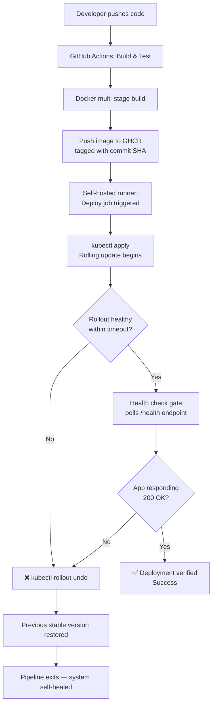
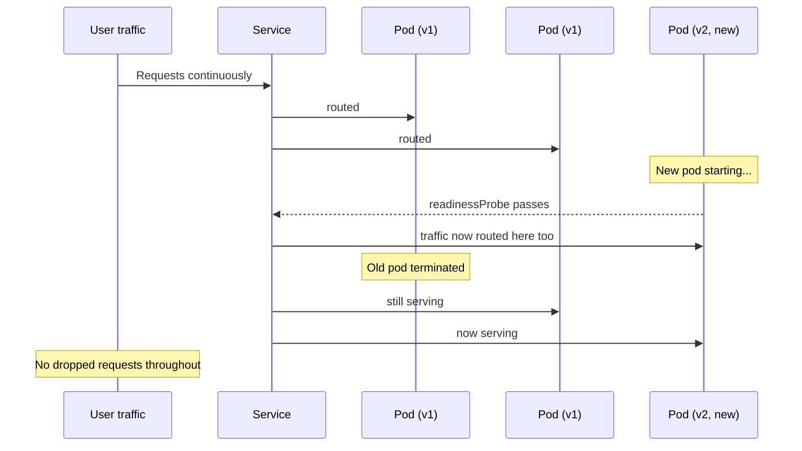

# 🛡️ Guardrail

**A self-healing CI/CD pipeline for Kubernetes — zero-downtime deploys with automated health verification and rollback.**

Built to solve a common production problem: deployments that fail silently and require manual firefighting. Guardrail deploys, verifies, and heals itself — no human intervention required when something goes wrong.

---

## 🎯 Problem Statement

> Manual production deployments lack automated health validation and rollback, leading to prolonged downtime when a bad release is pushed. Engineers are forced to manually diagnose and patch under pressure, increasing recovery time and blast radius.

**Guardrail solves this** by making every deployment self-verifying and self-healing:

```
Bad deploy goes out  →  Health check fails  →  System rolls back automatically  →  Zero manual intervention
```

---

## 🏗️ Architecture



---

## 🔁 Zero-Downtime Rolling Update Flow



---

## ⚙️ Tech Stack

| Layer | Tool | Why |
|---|---|---|
| Application | **Go** | Compiles to a static binary — enables minimal container images |
| Containerization | **Docker (multi-stage build)** | Separates build environment from runtime for a tiny, secure final image |
| Orchestration | **Kubernetes (kubeadm)** | Native rolling updates, self-healing, declarative infra |
| CI | **GitHub Actions** | Automated build, test, tag, and push on every commit |
| CD | **GitHub Actions (self-hosted runner)** | Deploys directly to a private, non-internet-facing cluster |
| Registry | **GitHub Container Registry (GHCR)** | Immutable, SHA-tagged image storage |
| Verification | **Custom Bash health-check gate** | Independent, second layer of health verification beyond Kubernetes' own probes |

---

## 📊 Results & Numbers

| Metric | Result |
|---|---|
| **Final container image size** | **~12.1 MB** (vs. typical 150–200MB Python/Node images) |
| **Base build image (discarded)** | ~800 MB — never shipped, thanks to multi-stage builds |
| **Replica count** | 3 pods per deployment, spread across nodes via `topologySpreadConstraints` |
| **Max unavailable during rollout** | 0 pods (3 of 3 always serving traffic) |
| **Health check gate timeout** | 60 seconds, polled every 3 seconds (validates body + `EXPECTED_VERSION`) |
| **Rollout timeout before auto-rollback** | 120 seconds (`kubectl rollout status` timeout) |
| **Downtime during a healthy deploy** | **0 seconds** (rolling update with `maxUnavailable: 0`; verify with continuous curl) |
| **Downtime during a failed deploy** | **~0 seconds when readiness gates hold** — traffic is only sent to `Ready` pods; a version that returns `200` on `/health` but `500` on `/` can still serve errors until the external gate rolls back — hence the version-aware `health-check.sh` + `rollout undo` |
| **Manual steps required on failure** | **0** — fully automated detection + rollback (pipeline still exits non-zero so the failure is visible) |

---

## 🔢 Versioning Strategy

- Every image is tagged with its **Git commit SHA** (`ghcr.io/.../guardrail:<sha>`) — never `:latest` in deployments (CI deploys via `kubectl set image`, never `sed` on YAML).
- `APP_VERSION` is injected at deploy time (`kubectl set env ... APP_VERSION=<sha>`) so `/health` reports the exact running SHA — default `dev` never masquerades as a release.
- This makes every running version **traceable back to an exact commit**.
- `kubectl rollout undo` uses Kubernetes' built-in revision history (`revisionHistoryLimit: 10`) to restore the exact prior image — no guessing what "last stable" means.

```
ghcr.io/gaouravpatil/guardrail:b040f7f4838f3f4302468c30cca9f2b5940481ba
                                └──────────────── commit SHA ────────────────┘
```

---

## ✅ Phases Completed

| Phase | Description | Status |
|---|---|---|
| 1 | Containerized Go app with multi-stage Docker build | ✅ Done |
| 2 | Pushed to GitHub, version control established | ✅ Done |
| 3 | GitHub Actions CI — build, test, tag, push to GHCR | ✅ Done |
| 4 | Deployed to Kubernetes with rolling update strategy | ✅ Done |
| 5 | Live zero-downtime rolling update demonstrated (v1 → v2) | ✅ Done |
| 6 | Independent health-check gate script (`health-check.sh`) | ✅ Done |
| 7 | Automated rollback on failed health check | ✅ Done |
| 7b | Full CI/CD wiring via self-hosted runner — push-to-deploy, fully automated | ✅ Done |

---

## 🧠 What This Project Demonstrates

- Multi-stage Docker builds for minimal, secure production images
- Kubernetes rolling updates with `readinessProbe` / `livenessProbe` gating
- CI/CD pipeline design with distinct build and deploy stages
- Self-hosted GitHub Actions runners for deploying to private/non-public infrastructure
- Defense-in-depth health verification (Kubernetes' own probes **+** an independent external check)
- Automated rollback using Kubernetes' native revision history
- Immutable, traceable image versioning via commit SHA tagging

---

## 📁 Project Structure

```
guardrail/
├── .github/workflows/ci.yml     # CI (vet/test/scan/push) + CD (immutable SHA deploy)
├── Dockerfile                   # Pinned multi-stage build → ~10MB static binary, non-root
├── .dockerignore                # Keeps build context ~12MB (excludes actions-runner/, .git)
├── main.go                      # App with /health, /ready, /live endpoints
├── main_test.go                 # Unit tests (handlers, metrics, panic recovery)
├── go.mod
├── k8s/
│   ├── 00-namespace.yaml                # guardrail namespace
│   ├── 01-deployments/guardrail.yaml    # 3 replicas, zero-downtime rollout, probes
│   ├── 02-services/guardrail.yaml       # ClusterIP service
│   ├── 03-configs/guardrail-config.yaml # PORT (non-sensitive)
│   └── 06-ingress/guardrail.yaml        # nginx Ingress for guardrail.gaourav.space
└── scripts/
    ├── health-check.sh          # Version-aware gate (body + EXPECTED_VERSION check)
    └── deploy-and-verify.sh     # kubectl set image → verify → waited rollback
```

---

## 🚀 Getting Started

### Prerequisites

| Tool | Version | Purpose |
|---|---|---|
| **Go** | 1.23+ | Build the application locally |
| **Docker** | 20.10+ | Build container images |
| **kubectl** | 1.28+ | Interact with your Kubernetes cluster |
| **Kubernetes cluster** | 1.28+ | Runtime environment (kubeadm, minikube, or kind) |
| **Git** | 2.30+ | Version control |

### 1. Clone & Build Locally

```bash
# Clone the repository
git clone https://github.com/GaouravPatil/Guardrail.git
cd Guardrail

# Install Go dependencies
go mod download

# Build the binary
CGO_ENABLED=0 go build -o server main.go

# Run locally
./server
# → Server starts on http://localhost:5000
```

Verify it's running:

```bash
curl http://localhost:5000/health
# {"status":"healthy","version":"dev"}
```

### 2. Build the Docker Image

```bash
# Build the multi-stage image (~12.1 MB final size)
docker build -t guardrail:local .

# Run the container
docker run -p 5000:5000 guardrail:local
```

### 3. Deploy to Kubernetes

```bash
# Apply in order: namespace -> deployments -> services -> configs -> ingress
kubectl apply -f k8s/00-namespace.yaml
kubectl apply -R -f k8s/01-deployments
kubectl apply -R -f k8s/02-services
kubectl apply -R -f k8s/03-configs
kubectl apply -R -f k8s/06-ingress

# Verify pods are running (3 replicas)
kubectl -n guardrail get pods -l app=guardrail

# Check rollout status
kubectl -n guardrail rollout status deployment/guardrail
```

Access the app via port-forward (Service is ClusterIP; expose externally with the Ingress):

```bash
kubectl -n guardrail port-forward svc/guardrail 5000:5000
curl http://localhost:5000/health
```

### 4. CI/CD Pipeline Setup

The pipeline runs automatically on every push to `main`. To enable it on your fork:

1. **GHCR access** — GitHub Actions uses `GITHUB_TOKEN` (automatic) to push images to `ghcr.io`
2. **Self-hosted runner** — The deploy job runs on a self-hosted runner connected to your Kubernetes cluster:
   ```bash
   # On your cluster node, set up a GitHub Actions runner:
   # Settings → Actions → Runners → New self-hosted runner
   # Follow GitHub's setup instructions for Linux
   ```
3. **Push and watch** — Every push to `main` triggers: build → push to GHCR → deploy → health verify → auto-rollback if unhealthy

### 5. Test the Self-Healing Rollback

Simulate a bad deploy to see auto-rollback in action:

```bash
# Deploy a known-bad image tag
kubectl set image deployment/guardrail guardrail=ghcr.io/gaouravpatil/guardrail:nonexistent

# Watch Kubernetes detect the failure and the script roll back
./scripts/deploy-and-verify.sh
# → Health check fails → automatic rollback → previous version restored
```

---
